<a href="https://fireflysoftware.io/openplatform/">
<picture>
  <source media="(max-width: 640px) and (prefers-color-scheme: dark)" srcset="https://raw.githubusercontent.com/firefly-oss/.github/main/profile/assets/banner-narrow-dark.svg">
  <source media="(max-width: 640px)" srcset="https://raw.githubusercontent.com/firefly-oss/.github/main/profile/assets/banner-narrow-light.svg">
  <source media="(prefers-color-scheme: dark)" srcset="https://raw.githubusercontent.com/firefly-oss/.github/main/profile/assets/banner-dark.svg">
  
</picture>
</a>

# Firefly OpenPlatform - Core Insurance - Claims

Developed by the Firefly Software Foundation. [dev@fireflysoftware.io](mailto:dev@fireflysoftware.io)

[Website](https://fireflysoftware.io/) · [OpenPlatform](https://fireflysoftware.io/openplatform/) · [Module catalogue](https://fireflysoftware.io/openplatform/modules/)

Core repository for claim notification, parties, coverage references, reserves, assessments, evidence references, and authorized settlements.

Repository: [https://github.com/firefly-oss/core-insurance-claims](https://github.com/firefly-oss/core-insurance-claims)

Stores the claim file. Settlement records may point at a payment order. Paying that order is core-banking-payments. The claimant is a customer party. The policy and contract are identifiers, not copies of those records.

This is a **core** service. It owns its tables and exposes a reactive CRUD API. It does not call other core services. Domain orchestration is intentionally not in this repository.

## What it does not own

- Policy terms. policyId points at core-insurance-policies.
- The agreement. contractId points at core-common-contract-mgmt.
- Claimant and payee records. party ids point at core-common-customer-mgmt.
- Evidence files. documentId points at core-common-document-mgmt.
- Payment execution. paymentOrderId points at core-banking-payments.
- Premium accounting. That is core-insurance-financials.

Cross-service identifiers are UUID columns without a database foreign key. A missing party, contract, product, document, distributor, policy, claim, or payment order is not enforced here. The domain layer, when it exists, is responsible for that coordination.

## Module structure

| Module | Purpose |
|--------|---------|
| `core-insurance-claims-interfaces` | DTOs and enums |
| `core-insurance-claims-models` | R2DBC entities, repositories, Flyway migrations |
| `core-insurance-claims-core` | Services and MapStruct mappers |
| `core-insurance-claims-web` | Spring Boot application and REST controllers |
| `core-insurance-claims-sdk` | Reactive Java client generated from the OpenAPI document |

## Data model

```mermaid
erDiagram
    CLAIM {
        uuid claim_id PK
        uuid tenant_id
        varchar(64) claim_number
        uuid policy_id
        uuid contract_id
        uuid policy_transaction_id
        claim_status_enum claim_status
        date loss_date
        timestamp notified_at
        varchar(64) cause_code
        text description
        varchar(3) currency
    }
    CLAIM ||--o{ CLAIM_PARTY : contains
    CLAIM_PARTY {
        uuid claim_party_id PK
        uuid claim_id FK
        uuid party_id
        claim_party_role_enum role
    }
    CLAIM ||--o{ CLAIM_COVERAGE : contains
    CLAIM_COVERAGE {
        uuid claim_coverage_id PK
        uuid claim_id FK
        uuid coverage_id
        decimal claimed_amount
        varchar(3) currency
    }
    CLAIM ||--o{ CLAIM_RESERVE : contains
    CLAIM_RESERVE {
        uuid claim_reserve_id PK
        uuid claim_id FK
        reserve_type_enum reserve_type
        decimal amount
        varchar(3) currency
        timestamp effective_at
    }
    CLAIM ||--o{ CLAIM_ASSESSMENT : contains
    CLAIM_ASSESSMENT {
        uuid claim_assessment_id PK
        uuid claim_id FK
        assessment_outcome_enum assessment_outcome
        decimal assessed_amount
        text notes
        timestamp assessed_at
    }
    CLAIM ||--o{ CLAIM_EVIDENCE : contains
    CLAIM_EVIDENCE {
        uuid claim_evidence_id PK
        uuid claim_id FK
        uuid document_id
        claim_evidence_type_enum evidence_type
        timestamp received_at
    }
    CLAIM ||--o{ CLAIM_SETTLEMENT : contains
    CLAIM_SETTLEMENT {
        uuid claim_settlement_id PK
        uuid claim_id FK
        uuid payee_party_id
        settlement_status_enum settlement_status
        decimal authorized_amount
        varchar(3) currency
        uuid payment_order_id
        timestamp authorized_at
    }
    CLAIM ||--o{ CLAIM_STATUS_HISTORY : contains
    CLAIM_STATUS_HISTORY {
        uuid claim_status_history_id PK
        uuid claim_id FK
        claim_status_enum claim_status
        varchar(500) status_reason
        timestamp changed_at
    }
    CLAIM ||--o{ COVERAGE_CHECK : contains
    COVERAGE_CHECK {
        uuid coverage_check_id PK
        uuid claim_id FK
        uuid policy_id
        uuid coverage_id
        boolean in_force
        boolean trigger_met
        decimal deductible_amount
        coverage_check_outcome_enum check_outcome
        timestamp checked_at
    }
    CLAIM ||--o{ CLAIM_TRIAGE : contains
    CLAIM_TRIAGE {
        uuid claim_triage_id PK
        uuid claim_id FK
        triage_path_enum triage_path
        timestamp triaged_at
        text notes
    }
    CLAIM ||--o{ ADJUSTER_ASSIGNMENT : contains
    ADJUSTER_ASSIGNMENT {
        uuid adjuster_assignment_id PK
        uuid claim_id FK
        uuid adjuster_party_id
        timestamp assigned_at
        assignment_status_enum assignment_status
    }
    CLAIM ||--o{ FRAUD_INDICATOR : contains
    FRAUD_INDICATOR {
        uuid fraud_indicator_id PK
        uuid claim_id FK
        varchar(64) indicator_code
        indicator_severity_enum severity
        timestamp noted_at
        text notes
    }
    CLAIM ||--o{ SIU_REFERRAL : contains
    SIU_REFERRAL {
        uuid siu_referral_id PK
        uuid claim_id FK
        siu_referral_status_enum referral_status
        timestamp referred_at
        text reason
    }
    CLAIM ||--o{ CLAIM_RECOVERY : contains
    CLAIM_RECOVERY {
        uuid claim_recovery_id PK
        uuid claim_id FK
        recovery_type_enum recovery_type
        recovery_status_enum recovery_status
        decimal expected_amount
        decimal recovered_amount
        varchar(3) currency
        uuid counterparty_party_id
    }
    CLAIM ||--o{ CLAIM_DENIAL : contains
    CLAIM_DENIAL {
        uuid claim_denial_id PK
        uuid claim_id FK
        text denial_reason
        timestamp denied_at
        varchar(200) authority_reference
    }
```



Fields that point at another Firefly service are logical references. Foreign keys exist only inside this database.

## API

| Method | Path | Purpose |
|--------|------|---------|
| POST | `/api/v1/claims/filter` | Filter claims |
| POST | `/api/v1/claims` | Create a Claim |
| GET | `/api/v1/claims/{claimId}` | Get a Claim |
| PUT | `/api/v1/claims/{claimId}` | Update a Claim |
| DELETE | `/api/v1/claims/{claimId}` | Delete a Claim |
| POST | `/api/v1/claims/{claimId}/parties/filter` | Filter claimparties |
| POST | `/api/v1/claims/{claimId}/parties` | Create a ClaimParty |
| GET | `/api/v1/claims/{claimId}/parties/{claimPartyId}` | Get a ClaimParty |
| PUT | `/api/v1/claims/{claimId}/parties/{claimPartyId}` | Update a ClaimParty |
| DELETE | `/api/v1/claims/{claimId}/parties/{claimPartyId}` | Delete a ClaimParty |
| POST | `/api/v1/claims/{claimId}/coverages/filter` | Filter claimcoverages |
| POST | `/api/v1/claims/{claimId}/coverages` | Create a ClaimCoverage |
| GET | `/api/v1/claims/{claimId}/coverages/{claimCoverageId}` | Get a ClaimCoverage |
| PUT | `/api/v1/claims/{claimId}/coverages/{claimCoverageId}` | Update a ClaimCoverage |
| DELETE | `/api/v1/claims/{claimId}/coverages/{claimCoverageId}` | Delete a ClaimCoverage |
| POST | `/api/v1/claims/{claimId}/reserves/filter` | Filter claimreserves |
| POST | `/api/v1/claims/{claimId}/reserves` | Create a ClaimReserve |
| GET | `/api/v1/claims/{claimId}/reserves/{claimReserveId}` | Get a ClaimReserve |
| PUT | `/api/v1/claims/{claimId}/reserves/{claimReserveId}` | Update a ClaimReserve |
| DELETE | `/api/v1/claims/{claimId}/reserves/{claimReserveId}` | Delete a ClaimReserve |
| POST | `/api/v1/claims/{claimId}/assessments/filter` | Filter claimassessments |
| POST | `/api/v1/claims/{claimId}/assessments` | Create a ClaimAssessment |
| GET | `/api/v1/claims/{claimId}/assessments/{claimAssessmentId}` | Get a ClaimAssessment |
| PUT | `/api/v1/claims/{claimId}/assessments/{claimAssessmentId}` | Update a ClaimAssessment |
| DELETE | `/api/v1/claims/{claimId}/assessments/{claimAssessmentId}` | Delete a ClaimAssessment |
| POST | `/api/v1/claims/{claimId}/evidence/filter` | Filter claimevidenceitems |
| POST | `/api/v1/claims/{claimId}/evidence` | Create a ClaimEvidence |
| GET | `/api/v1/claims/{claimId}/evidence/{claimEvidenceId}` | Get a ClaimEvidence |
| PUT | `/api/v1/claims/{claimId}/evidence/{claimEvidenceId}` | Update a ClaimEvidence |
| DELETE | `/api/v1/claims/{claimId}/evidence/{claimEvidenceId}` | Delete a ClaimEvidence |
| POST | `/api/v1/claims/{claimId}/settlements/filter` | Filter claimsettlements |
| POST | `/api/v1/claims/{claimId}/settlements` | Create a ClaimSettlement |
| GET | `/api/v1/claims/{claimId}/settlements/{claimSettlementId}` | Get a ClaimSettlement |
| PUT | `/api/v1/claims/{claimId}/settlements/{claimSettlementId}` | Update a ClaimSettlement |
| DELETE | `/api/v1/claims/{claimId}/settlements/{claimSettlementId}` | Delete a ClaimSettlement |
| POST | `/api/v1/claims/{claimId}/status-history/filter` | Filter claimstatushistories |
| POST | `/api/v1/claims/{claimId}/status-history` | Create a ClaimStatusHistory |
| GET | `/api/v1/claims/{claimId}/status-history/{claimStatusHistoryId}` | Get a ClaimStatusHistory |
| PUT | `/api/v1/claims/{claimId}/status-history/{claimStatusHistoryId}` | Update a ClaimStatusHistory |
| DELETE | `/api/v1/claims/{claimId}/status-history/{claimStatusHistoryId}` | Delete a ClaimStatusHistory |
| POST | `/api/v1/claims/{claimId}/coverage-checks/filter` | Filter coveragechecks |
| POST | `/api/v1/claims/{claimId}/coverage-checks` | Create a CoverageCheck |
| GET | `/api/v1/claims/{claimId}/coverage-checks/{coverageCheckId}` | Get a CoverageCheck |
| PUT | `/api/v1/claims/{claimId}/coverage-checks/{coverageCheckId}` | Update a CoverageCheck |
| DELETE | `/api/v1/claims/{claimId}/coverage-checks/{coverageCheckId}` | Delete a CoverageCheck |
| POST | `/api/v1/claims/{claimId}/triage/filter` | Filter claimtriages |
| POST | `/api/v1/claims/{claimId}/triage` | Create a ClaimTriage |
| GET | `/api/v1/claims/{claimId}/triage/{claimTriageId}` | Get a ClaimTriage |
| PUT | `/api/v1/claims/{claimId}/triage/{claimTriageId}` | Update a ClaimTriage |
| DELETE | `/api/v1/claims/{claimId}/triage/{claimTriageId}` | Delete a ClaimTriage |
| POST | `/api/v1/claims/{claimId}/adjusters/filter` | Filter adjusterassignments |
| POST | `/api/v1/claims/{claimId}/adjusters` | Create a AdjusterAssignment |
| GET | `/api/v1/claims/{claimId}/adjusters/{adjusterAssignmentId}` | Get a AdjusterAssignment |
| PUT | `/api/v1/claims/{claimId}/adjusters/{adjusterAssignmentId}` | Update a AdjusterAssignment |
| DELETE | `/api/v1/claims/{claimId}/adjusters/{adjusterAssignmentId}` | Delete a AdjusterAssignment |
| POST | `/api/v1/claims/{claimId}/fraud-indicators/filter` | Filter fraudindicators |
| POST | `/api/v1/claims/{claimId}/fraud-indicators` | Create a FraudIndicator |
| GET | `/api/v1/claims/{claimId}/fraud-indicators/{fraudIndicatorId}` | Get a FraudIndicator |
| PUT | `/api/v1/claims/{claimId}/fraud-indicators/{fraudIndicatorId}` | Update a FraudIndicator |
| DELETE | `/api/v1/claims/{claimId}/fraud-indicators/{fraudIndicatorId}` | Delete a FraudIndicator |
| POST | `/api/v1/claims/{claimId}/siu-referrals/filter` | Filter siureferrals |
| POST | `/api/v1/claims/{claimId}/siu-referrals` | Create a SiuReferral |
| GET | `/api/v1/claims/{claimId}/siu-referrals/{siuReferralId}` | Get a SiuReferral |
| PUT | `/api/v1/claims/{claimId}/siu-referrals/{siuReferralId}` | Update a SiuReferral |
| DELETE | `/api/v1/claims/{claimId}/siu-referrals/{siuReferralId}` | Delete a SiuReferral |
| POST | `/api/v1/claims/{claimId}/recoveries/filter` | Filter claimrecoveries |
| POST | `/api/v1/claims/{claimId}/recoveries` | Create a ClaimRecovery |
| GET | `/api/v1/claims/{claimId}/recoveries/{claimRecoveryId}` | Get a ClaimRecovery |
| PUT | `/api/v1/claims/{claimId}/recoveries/{claimRecoveryId}` | Update a ClaimRecovery |
| DELETE | `/api/v1/claims/{claimId}/recoveries/{claimRecoveryId}` | Delete a ClaimRecovery |
| POST | `/api/v1/claims/{claimId}/denials/filter` | Filter claimdenials |
| POST | `/api/v1/claims/{claimId}/denials` | Create a ClaimDenial |
| GET | `/api/v1/claims/{claimId}/denials/{claimDenialId}` | Get a ClaimDenial |
| PUT | `/api/v1/claims/{claimId}/denials/{claimDenialId}` | Update a ClaimDenial |
| DELETE | `/api/v1/claims/{claimId}/denials/{claimDenialId}` | Delete a ClaimDenial |

Missing rows return HTTP 404 through `ResourceNotFoundException`. A child row whose parent id does not match the path also returns 404.

Swagger UI: `/swagger-ui.html`. OpenAPI: `/v3/api-docs`.

## Configuration

| Variable | Description |
|----------|-------------|
| `DB_HOST` | PostgreSQL host |
| `DB_PORT` | PostgreSQL port |
| `DB_NAME` | Database name |
| `DB_USERNAME` | Database user |
| `DB_PASSWORD` | Database password |
| `DB_SSL_MODE` | `disable`, `require`, or another PostgreSQL SSL mode |
| `SERVER_ADDRESS` | Bind address, default `localhost` |
| `SERVER_PORT` | HTTP port, default `8080` |

Create an empty database before the first start. Flyway applies `db/migration` on boot.

## Build and run

```bash
mvn clean verify
mvn -pl core-insurance-claims-web spring-boot:run
```

Java 25 and Maven 3.9 or newer. The parent POM is `com.firefly:firefly-parent:26.10.20`.

## Stack

Java 25, Spring Boot WebFlux, virtual threads, Spring Data R2DBC, PostgreSQL, Flyway, MapStruct, SpringDoc, Micrometer Prometheus.

## Actuator

| Endpoint | Purpose |
|----------|---------|
| `/actuator/health` | Liveness and readiness |
| `/actuator/info` | Build information |
| `/actuator/prometheus` | Metrics |

## Publisher

| | |
|--|--|
| Developed by | Firefly Software Foundation |
| Development contact | dev@fireflysoftware.io |
| Platform | https://openplatform.fireflysoftware.io |
| Website | https://fireflysoftware.io |
